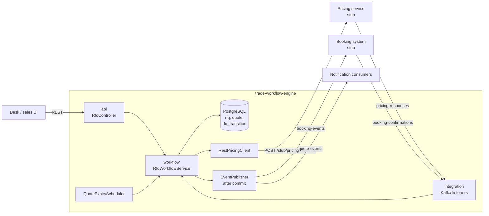
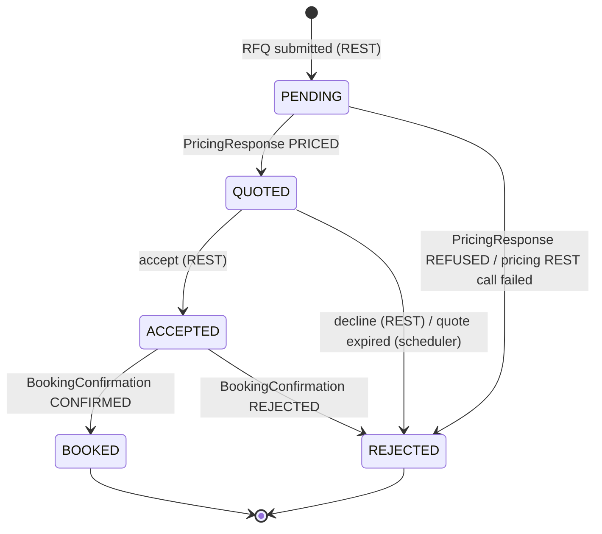
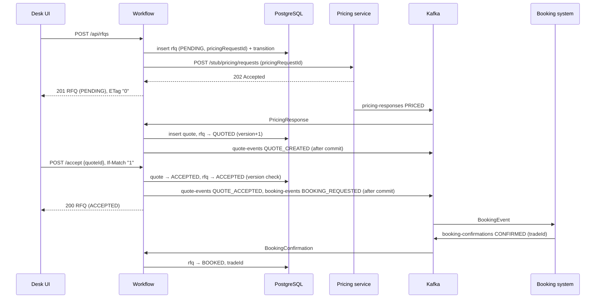

# Design: Trade Workflow Service

## 1. Purpose and scope

The service owns the lifecycle of a client's **request for quote** (RFQ) on a structured
product, from submission to a booked trade. It does not price and it does not book. It
coordinates the systems that do:

| System | Role | Integration |
|---|---|---|
| Desk / sales UI | Submits RFQs, accepts or declines quotes | REST (`/api/rfqs`) |
| Pricing service | Prices the product asynchronously | REST request, Kafka response (`pricing-responses`) |
| Notification consumers (sales UI, client portal) | Learn about quotes | Kafka (`quote-events`) |
| Booking system | Books the trade, assigns a trade id | Kafka out (`booking-events`), Kafka in (`booking-confirmations`) |

The pricing service and booking system are simulated by stubs inside the application (the
`stub` package). They talk to the workflow only through the same HTTP and Kafka interfaces a
real system would use. Disabling them (`stubs.enabled=false`) leaves the workflow unchanged.

## 2. Architecture



**Layers:**

* `api` is HTTP only: validation, ETag/If-Match, and mapping exceptions to problem details.
* `workflow` holds every business decision. It depends on the domain, the repository, a
  `PricingGateway` port and the `EventPublisher`.
* `domain` holds the entities and the state machine.
  * `Rfq.transitionTo` is the only way to change status.
  * It enforces the allowed transitions and appends to the audit trail in the same step.
* `integration` and `messaging` are the adapters to REST and Kafka. Event classes are plain
  records; they are the wire contracts.

## 3. State machine



| From | To | Trigger | Actor | Side effects |
|---|---|---|---|---|
| (none) | PENDING | `POST /api/rfqs` | desk user (`X-Desk-User`) | Pricing request sent over REST |
| PENDING | QUOTED | `pricing-responses` PRICED matching the RFQ's `pricingRequestId` | `pricing-service` | Quote created (`validUntil = now + quote-ttl`); `QUOTE_CREATED` on `quote-events` |
| PENDING | REJECTED | `pricing-responses` REFUSED | `pricing-service` | reason `PRICING_REFUSED` |
| PENDING | REJECTED | Pricing REST call fails or times out | `system` | reason `PRICING_UNAVAILABLE` |
| QUOTED | ACCEPTED | `POST /accept` with the active, unexpired quote | desk user | Quote → ACCEPTED; `QUOTE_ACCEPTED` on `quote-events`; `BOOKING_REQUESTED` on `booking-events` |
| QUOTED | REJECTED | `POST /decline` | desk user | Quote → DECLINED; `QUOTE_DECLINED`; reason `CLIENT_DECLINED` |
| QUOTED | REJECTED | Scheduler finds the active quote past `validUntil` | `system` | Quote → EXPIRED; `QUOTE_EXPIRED`; reason `QUOTE_EXPIRED` |
| ACCEPTED | BOOKED | `booking-confirmations` CONFIRMED for the accepted quote | `booking-system` | `tradeId` stored |
| ACCEPTED | REJECTED | `booking-confirmations` REJECTED | `booking-system` | reason `BOOKING_REJECTED` |

How violations are handled:

* **From a REST call**: any transition not in this table throws `InvalidTransitionException`,
  which becomes HTTP 409. Examples are accepting a REJECTED RFQ, or accepting twice.
* **From Kafka**: a message that doesn't fit the current state is not an error. It is a
  duplicate or a late message, and it is ignored (see section 6).

**Quote status** (`ACTIVE`, `ACCEPTED`, `DECLINED`, `EXPIRED`) is tracked separately:

* An RFQ has at most one active quote.
* The quote id must be named explicitly on accept and decline, so a client can't accept a price
  they haven't seen.

## 4. Data flow

### 4.1 Happy path



**Why the pricing request id is generated by the workflow.** The workflow generates
`pricingRequestId` and stores it in the same transaction that creates the RFQ, before calling
the pricing service. The asynchronous response can then never arrive before the workflow knows
which request it belongs to. Responses for any other request id are ignored.

### 4.2 Failure paths

* **Pricing service unreachable.** The REST call has a 2 s connect and read timeout. On failure
  the RFQ is rejected immediately with `PRICING_UNAVAILABLE`. A desk can resubmit. Automatic
  retry is left out, because a stale RFQ is worse than a visible rejection.
* **Pricing refused** (the stub refuses notionals above the desk limit). The RFQ goes to
  REJECTED with the pricing service's reason.
* **Quote expires.** `QuoteExpiryScheduler` runs every `expiry-check-interval`:
  * A partial index on `quote(valid_until) where status = 'ACTIVE'` finds candidates.
  * Each candidate is expired in its own transaction.
  * An accept that arrives after `validUntil` but before the sweep is refused with 409, so
    nobody can trade on a stale price.
* **Booking rejected** (the stub rejects client ids starting with `BLOCKED`, simulating KYC).
  The RFQ goes from ACCEPTED to REJECTED with the booking system's reason.

## 5. Integration contracts

All Kafka messages:

* are UTF-8 JSON values with string keys;
* use the **RFQ id as the key**, so every event for one RFQ lands on the same partition in
  order;
* carry an `eventId` (a UUID), which lets consumers deduplicate;
* use ISO-8601 UTC timestamps;
* express prices in **percent of notional**.

Topics are created at start-up with 3 partitions. The workflow consumes with group
`trade-workflow-engine` and `read_committed`. Producers use `acks=all` and idempotence.

### 5.1 REST: pricing request (workflow → pricing service)

`POST {PRICING_BASE_URL}/stub/pricing/requests` returns `202 Accepted` with
`{"pricingRequestId": "...", "status": "ACCEPTED"}`.

```json
{
  "pricingRequestId": "PR-1f0c...",
  "rfqId": "7a6495b2-ed47-45e0-9ab2-373f342c2771",
  "underlier": "SX5E",
  "productType": "AUTOCALLABLE",
  "notional": 5000000,
  "currency": "EUR",
  "maturityMonths": 36
}
```

### 5.2 `pricing-responses` (pricing service → workflow)

```json
{
  "eventId": "c1d2...", "pricingRequestId": "PR-1f0c...", "rfqId": "7a6495b2-...",
  "status": "PRICED", "pricePct": 97.2900, "reason": null, "pricedAt": "2026-11-11T03:13:08.27Z"
}
```

`status` is `PRICED` or `REFUSED`. For `REFUSED`, `pricePct` is null and `reason` explains why.

### 5.3 `quote-events` (workflow → notification consumers)

```json
{
  "eventId": "...", "type": "QUOTE_CREATED", "rfqId": "...", "quoteId": "d7e6603a-...",
  "clientId": "CLIENT-ACME", "underlier": "SX5E", "productType": "AUTOCALLABLE",
  "notional": 5000000.00, "currency": "EUR", "pricePct": 97.2900,
  "validUntil": "2026-11-11T03:13:38.27Z", "occurredAt": "2026-11-11T03:13:08.28Z"
}
```

`type` is one of `QUOTE_CREATED`, `QUOTE_ACCEPTED`, `QUOTE_DECLINED` or `QUOTE_EXPIRED`.

### 5.4 `booking-events` (workflow → booking system)

```json
{
  "eventId": "9817d3f3-...", "type": "BOOKING_REQUESTED", "rfqId": "7a6495b2-...",
  "quoteId": "d7e6603a-...", "clientId": "CLIENT-ACME", "underlier": "SX5E",
  "productType": "AUTOCALLABLE", "notional": 5000000.00, "currency": "EUR",
  "maturityMonths": 36, "pricePct": 97.2900, "requestedAt": "2026-11-11T03:13:09.00Z"
}
```

### 5.5 `booking-confirmations` (booking system → workflow)

```json
{
  "eventId": "...", "rfqId": "7a6495b2-...", "quoteId": "d7e6603a-...",
  "status": "CONFIRMED", "tradeId": "TRD-95969527", "reason": null,
  "occurredAt": "2026-11-11T03:13:09.14Z"
}
```

`status` is `CONFIRMED` or `REJECTED`. A rejection carries `reason`.

### 5.6 REST API (desk → workflow)

The API is listed in the README. Its concurrency contract:

* Every RFQ response carries `ETag: "<version>"`.
* `accept` and `decline` accept an optional `If-Match`. A mismatch returns
  `412 Precondition Failed` with `currentVersion` in the problem body.

## 6. Consistency, concurrency and delivery

### Optimistic locking

`rfq` and `quote` have a `version` column mapped with JPA `@Version`. Concurrent desk activity
is resolved without locks held across requests:

* Two traders accept the same quote. Both read version N. The first `UPDATE ... WHERE
  version = N` wins. The second updates zero rows, gets an `ObjectOptimisticLockingFailureException`,
  and the caller receives 409 "Concurrent update". The integration test fires 8 simultaneous
  accepts and checks for exactly one success and exactly one booking event. In local runs all 7
  losers were stopped by the version check.
* An accept races the expiry sweep. Whichever commits first wins. The sweep catches the conflict,
  counts it in `workflow.optimistic.lock.conflicts`, and re-checks on its next run.
* A Kafka message races a desk action. The listener's transaction fails. Spring Kafka's
  `DefaultErrorHandler` retries the record 5 times, 200 ms apart, against fresh state. The
  handler is idempotent, so the retry either applies the change or ignores the message.

`If-Match` extends the same protection to the user's think time: a trader who accepts based on a
screen showing version 1 gets 412 if anything changed since.

### Transactions and event publishing

* **One short transaction per change.** Each state change runs in its own transaction
  (`TransactionTemplate`). The pricing REST call is made outside any transaction.
* **Publish only after commit.** Events are published from a `TransactionSynchronization` after
  commit. A rolled-back change, such as a lost optimistic-lock race, therefore never produces an
  event. The concurrent-accept test relies on this: one booking event, not up to 8.
* **The cost: events can be lost.** If the process crashes between commit and send, the event
  is lost. Delivery is at most once for that window. The production fix is a **transactional
  outbox**: write the event to an `outbox` table in the same transaction, and relay it with a
  poller or CDC. It is deliberately not built here; see section 9.

### Idempotent consumers

Kafka delivers at least once, so every handler checks that the message fits the current state
before acting:

* **Pricing response**: applied only if the RFQ is still PENDING and `pricingRequestId` matches.
* **Booking confirmation**: applied only if the RFQ is ACCEPTED and the named quote is the
  accepted one.

Anything else is logged and counted in `workflow.events.ignored{topic,reason}`. The integration
test replays a pricing response and checks that the RFQ, its quote count and its version are
unchanged. A record that still fails after retries goes to `<topic>.DLT` rather than blocking
the partition.

## 7. Persistence

Flyway owns the schema (`db/migration/V1__workflow_schema.sql`). Hibernate only validates it
(`ddl-auto: validate`).

| Table | Purpose | Notable columns |
|---|---|---|
| `rfq` | Current workflow state | `status`, `rejection_reason`, `pricing_request_id`, `trade_id`, `version` |
| `quote` | Firm prices, one active per RFQ | `price_pct`, `valid_until`, `status`, `version`; partial index on active quotes by expiry |
| `rfq_transition` | Append-only audit trail | `from_status`, `to_status`, `detail`, `actor`, `occurred_at` |

Money is stored as `numeric`: `notional` as `numeric(19,2)` and `price_pct` as `numeric(9,4)`.
Timestamps are `timestamptz`.

## 8. Observability

**Logs.** Spring Boot structured logging in Logstash JSON format, one object per line.

* Workflow log lines use SLF4J key-value pairs, which become top-level JSON fields: `rfqId`,
  `quoteId`, `pricePct`, `reason`, `tradeId`, `actor`.
* Kafka listeners add `kafkaTopic` and `kafkaOffset` to the MDC, so every line written while
  handling a message can be traced to it.
* An example line:

  ```json
  {"@timestamp":"2026-11-11T03:14:54.28Z","message":"quote created","logger_name":"...RfqWorkflowService",
   "level":"INFO","kafkaOffset":"1","kafkaTopic":"pricing-responses","rfqId":"0a9e9f90-...",
   "quoteId":"2bac8e6a-...","pricePct":97.12,"validUntil":"2026-11-11T03:15:24.28Z"}
  ```

**Metrics.** Micrometer, exposed at `/actuator/metrics` and `/actuator/prometheus`:

| Metric | Type | Tags |
|---|---|---|
| `rfq.submitted` | counter | `product` |
| `rfq.transitions` | counter | `from`, `to` |
| `rfq.rejected` | counter | `reason` |
| `rfq.time.to.quote`, `rfq.time.to.book` | timer (histogram) | – |
| `rfq.status.count` | gauge (DB count) | `status` |
| `workflow.events.ignored` | counter | `topic`, `reason` |
| `workflow.optimistic.lock.conflicts` | counter | `operation` (`api`, `expire-quote`, `pricing-response`, ...) |

Spring Boot and Spring Kafka add HTTP server, JVM, Hikari and Kafka client metrics as well.

**Health.** `/actuator/health` aggregates:

* `db`: the datasource.
* `kafka`: a custom indicator that calls `describeCluster` with a 3 s timeout.
* Liveness and readiness probes, for Kubernetes.

## 9. Trade-offs and limitations

* **Stubs in-process.** This keeps the demo to one deployable. The integration boundaries are
  still real HTTP and Kafka, so moving a stub out of the process changes configuration only.
* **No transactional outbox.** See section 6. This is the first thing to add before production
  use.
* **Simple quote expiry.** The sweep is a polling scheduler. With several service instances,
  each one runs it. That is safe, because optimistic locking makes the work idempotent, but
  wasteful. A real deployment would use ShedLock or a single leader.
* **Single currency and toy pricing.** The stub's price model is deterministic arithmetic, not a
  pricing model. There are no FX or limit checks beyond the stub's notional limit.
* **One quote per RFQ.** Re-quoting (requesting a new price after a decline or expiry) means
  submitting a new RFQ.
* **No authentication.** `X-Desk-User` is trusted as given. In production it would come from the
  authenticated principal.
